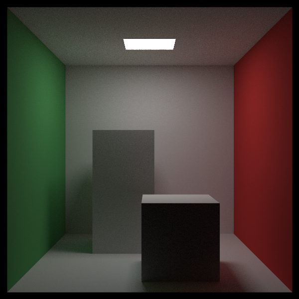

# **RayTracingInOneWeekSeries**

## **Result**
#### **Current Render Output:**

  

- Resolution = 600x600
- SPP = 200
- Max Ray Depth = 8

## **Third-Party Libraries**
1. [Image Loader - stb](https://github.com/nothings/stb)
2. [World Loader - rapidjson](https://github.com/Tencent/rapidjson)

## **References**
1. [Ray Tracing In One Weekend: The Book Series](https://raytracing.github.io/)
2. [Physically Based Rendering: From Theory To Implementation](https://www.pbr-book.org/)