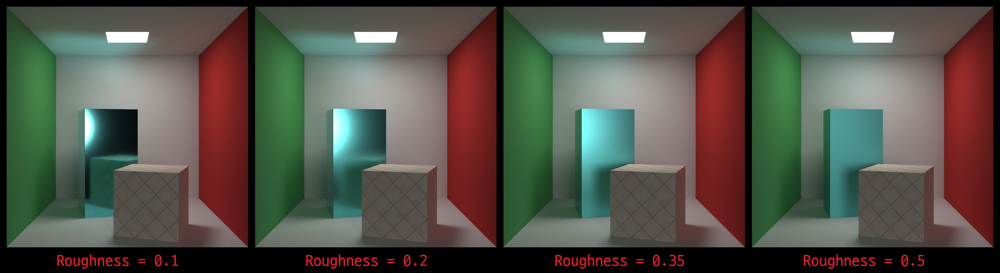

# **CPU-RayTracer**

An offline renderer written in C++, implementing Monte Carlo path tracing.

## **Features**
### **Rendering**
- Multi-threaded rendering (dynamic row scheduling)
- Stratified pixel sampling
- NEE (Next Event Estimation)
- MIS (Multiple Importance Sampling) using the power heuristic

### **Materials**
- Lambertian diffuse reflection
- GGX microfacet reflection
  - Smith masking-shadowing
  - GGX VNDF sampling (Visible Normal Distribution Function)
  - Schlick Fresnel approximation

### **Textures**
- Solid color
- Image
  - Diffuse albedo

### **Geometry**
- Sphere, rectangle, and cube
  - Uniform surface sampling (sphere, rectangle)
- BVH acceleration (Bounding Volume Hierarchy)
  - Longest-axis selection
  - Median splitting

## **Result**
#### **Render Configuration**
- Resolution = 1000x1000
- SPP = 4000
- Max Ray Depth = 6

#### **GGX Roughness Comparison**
<p>
  
</p>
Average Render Time: 1032.004 [s] (17m 12s)

## **Configuration**
### **Rendering**
`renderConfig.json` defines the rendering parameters.
``` json
{
    "Renderer": {
        "Resolution": [1000, 1000],
        "Sampling"  : {
            "SamplesPerPixel": 1000,
            "MaxRayDepth"    : 6
        }
    }
}
```
- Resolution — Output image [width, height]
- SamplesPerPixel — Number of samples per pixel
- MaxRayDepth — Maximum path depth

### **World (Scene)**
The default world configuration is located in the `resources/worlds` directory.

The world is defined in JSON and contains the following components:
- Camera
- Materials
- Objects
- Lights

## **Third-Party Libraries**
1. [Image — stb](https://github.com/nothings/stb)
2. [Json — rapidjson](https://github.com/Tencent/rapidjson)

## **References**
### **Books**
1. [Ray Tracing in One Weekend: The Book Series](https://raytracing.github.io/)
2. [Physically Based Rendering: From Theory to Implementation](https://www.pbr-book.org/)

### **Papers**
1. [Sampling the GGX Distribution of Visible Normals](https://jcgt.org/published/0007/04/01/)